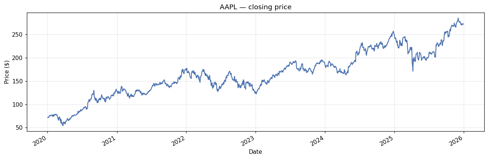
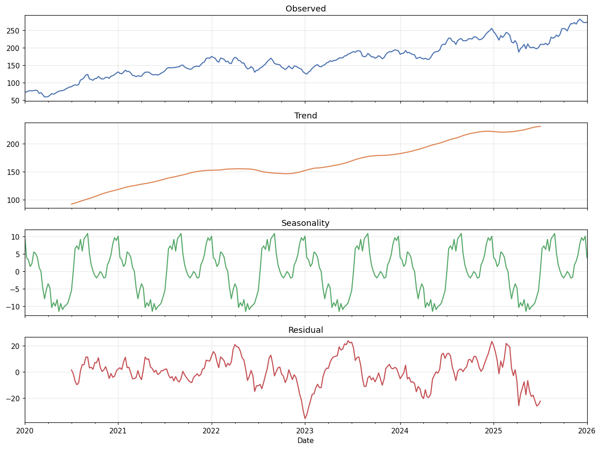
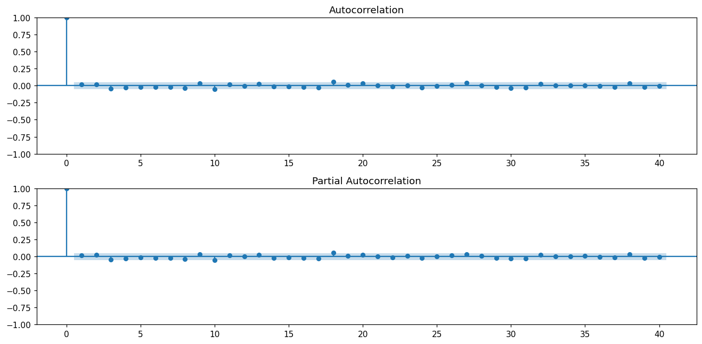
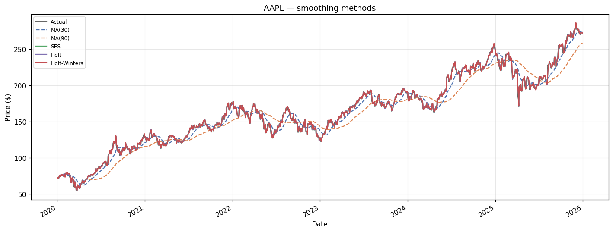
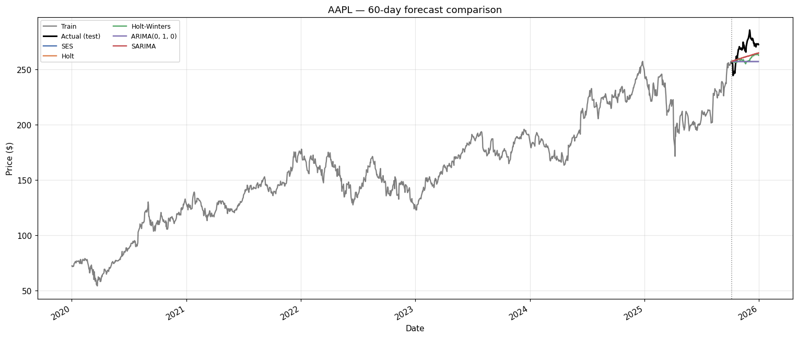
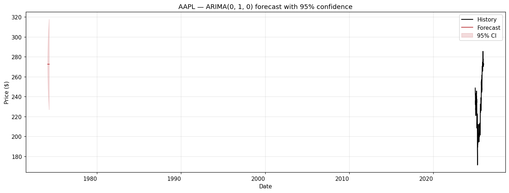

# 📈 Time Series Analysis & Forecasting: Apple Inc. (AAPL) Stock Prices

**Internship Project: Level 3 (Advanced) - Task 1**  
**Organization:** Codveda Technology  
**Role:** Data Science Intern  

## 📌 Project Overview
This project was completed as part of the **Level 3 (Advanced) Data Science Internship at Codveda Technology**. The primary objective was to analyze historical time-series data, decompose its underlying components, apply various smoothing techniques, and build robust statistical models (ARIMA/SARIMA) to forecast future values. 

For this project, I utilized historical stock market data for **Apple Inc. (AAPL)** spanning 2020 to 2025, using Python and its powerful statistical libraries.

### 🎯 Motive & Objectives
According to the project requirements, the main objectives were to:
*   Plot and decompose the time series into trend, seasonality, and residual components.
*   Implement moving average and exponential smoothing techniques.
*   Build an ARIMA or SARIMA model for forecasting.
*   Evaluate the models using metrics such as RMSE and MAPE, and visualize the forecasts.
*   Utilize tools: Python, pandas, statsmodels, matplotlib, and yfinance.

<!-- 📸 SCREENSHOT PLACEHOLDER 1 -->
<!-- INSTRUCTIONS: Upload the provided task requirement picture to your GitHub repository and replace the link below -->
 

---

## 📊 Dataset
The dataset consists of real historical trading data for Apple Inc. (AAPL) obtained via the `yfinance` API.
*   **Timeframe:** January 2020 to December 2025 (1,507 trading days).
*   **Feature Used:** Closing Price (Adjusted).

---

## ⚙️ Methodology & Implementation

### 1. Exploratory Data Analysis & Decomposition
*   **Raw Data Visualization:** Plotted the raw time series to identify general trends and volatility.
*   **Time Series Decomposition:** Used `seasonal_decompose` (Additive model, period=52 on weekly resampled data) to break the series into:
    *   **Trend:** The long-term direction of the stock price.
    *   **Seasonality:** Repeating short-term patterns (weekly/annual cycles).
    *   **Residual:** The random noise left over after removing trend and seasonality.
    *   *Insight:* The trend component accounted for the vast majority of the variance, while seasonality was relatively minor.

<!-- 📸 IMAGE PLACEHOLDER 2 -->

### 2. Stationarity Testing
*   **Augmented Dickey-Fuller (ADF) Test:** Performed on the raw price, first difference, and log first difference.
*   **Result:** The raw price was **non-stationary** (p=0.7896). After applying first-order differencing, the series became **stationary** (p=0.0000).
*   **ACF & PACF:** Plotted autocorrelation and partial autocorrelation functions to guide the selection of ARIMA parameters.

<!-- 📸 IMAGE PLACEHOLDER 3 -->

### 3. Smoothing Techniques
Implemented several smoothing techniques to reduce noise and identify underlying trends:
*   Moving Averages (MA 30, MA 90)
*   Simple Exponential Smoothing (SES)
*   Holt’s Linear Trend Method
*   Holt-Winters Seasonal Method

<!-- 📸 IMAGE PLACEHOLDER 4 -->

### 4. Model Building & Forecasting
*   **Data Split:** Chronological train/test split (80/20), reserving the last 60 trading days for testing.
*   **Models Trained:** SES, Holt, Holt-Winters, ARIMA, and SARIMA.
*   **ARIMA Optimization:** Conducted a grid search over (p, d, q) parameters. The best ARIMA model was found to be **(0, 1, 0)** with an AIC of 7272.1. 
*   **SARIMA:** Built a Seasonal ARIMA model with weekly seasonality `(1, 1, 1, 5)`.

---

## 📈 Results & Performance Evaluation

The models were evaluated on the test set (60-day horizon) using MSE, RMSE, MAE, and MAPE.

| Model | MSE | RMSE | MAE | MAPE |
| :--- | :--- | :--- | :--- | :--- |
| **Holt** | 116.51 | **10.79** | **9.62** | **3.55%** |
| SARIMA | 117.67 | 10.85 | 9.66 | 3.57% |
| Holt-Winters | 160.42 | 12.67 | 11.27 | 4.15% |
| ARIMA(0, 1, 0) | 215.94 | 14.69 | 13.24 | 4.87% |
| SES | 215.94 | 14.69 | 13.24 | 4.87% |

**🏆 Best Model: Holt's Linear Trend Method (RMSE = 10.79)**

### Visualizing the Forecasts
The visual comparison below highlights how the Holt model closely tracked the actual test data, outperforming the more complex SARIMA model in this specific 60-day horizon.

<!-- 📸 IMAGE PLACEHOLDER 5 -->

Finally, the ARIMA model was refit on the full dataset to project 60 days into the future, complete with 95% confidence intervals.

<!-- 📸 IMAGE PLACEHOLDER 6 -->

---

## 🧠 Knowledge Gained & Skills Acquired
During this internship project, I gained hands-on experience in:
1.  **Financial Data Acquisition:** Using `yfinance` to fetch and handle real-world, noisy financial data.
2.  **Time Series Diagnostics:** Mastering the ADF test to detect non-stationarity and applying differencing techniques to stabilize the mean.
3.  **Statistical Modeling:** Understanding the theoretical and practical differences between ARIMA, SARIMA, and Exponential Smoothing (Holt, Holt-Winters).
4.  **Model Selection & Evaluation:** Utilizing AIC for parameter tuning and implementing standard regression error metrics (RMSE, MAPE) to select the best model for a specific forecasting horizon.
5.  **Data Visualization:** Creating clear, professional plots using `matplotlib` to communicate complex time-series concepts and forecast confidence intervals.

## 💡 Conclusion
This project demonstrated that while complex models like SARIMA can capture seasonality, simpler models like **Holt's Linear Trend** often perform better in short-term stock price forecasting. Stock prices are highly volatile, and overfitting to noise (residuals) can hurt predictive performance. The Holt model achieved an impressive **3.55% MAPE**, proving its robustness for this specific dataset. Future work could involve introducing external macroeconomic indicators or exploring machine learning approaches like XGBoost for time series.

---

## 🛠️ Tools & Technologies
*   **Programming Language:** Python 3.13
*   **Data Manipulation:** Pandas, NumPy
*   **Visualization:** Matplotlib
*   **Statistical Modeling:** Statsmodels (ARIMA, SARIMA, Exponential Smoothing)
*   **Data Source:** yfinance

---
## 🤝 Contributing

Contributions, issues, and feature requests are welcome!  
Feel free to check 

---

## 📄 License

This project is licensed under the MIT License – see the [LICENSE](LICENSE) file for details.

---

## 👥 Author

**Your Name**  
- GitHub: [@lipril](https://github.com/lipril)  
- LinkedIn: [LinkedIn](https://www.linkedin.com/in/liprilomar/)
