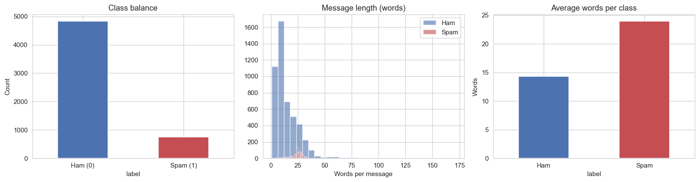
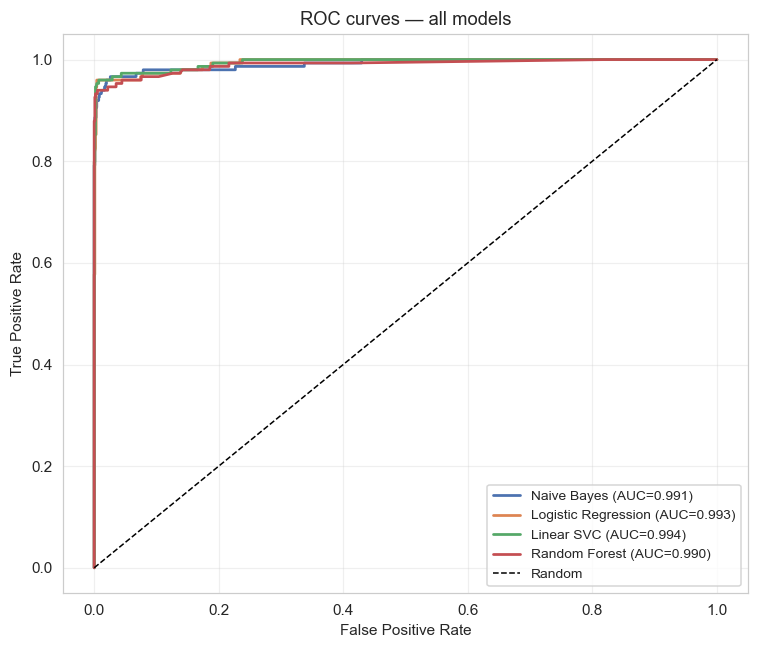
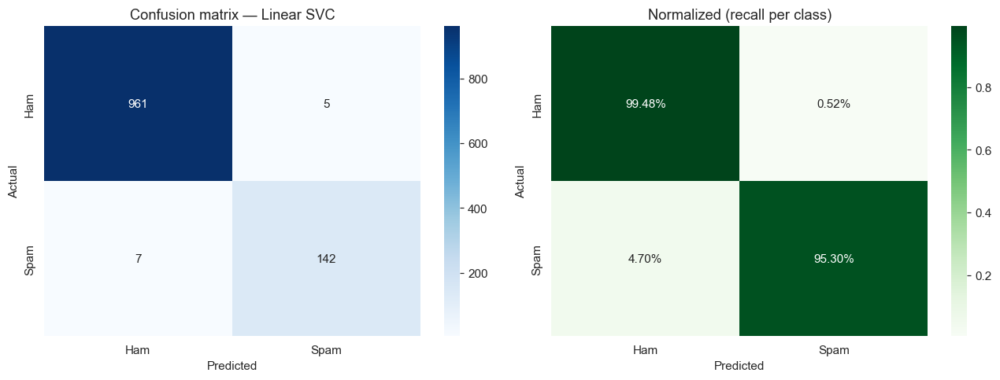
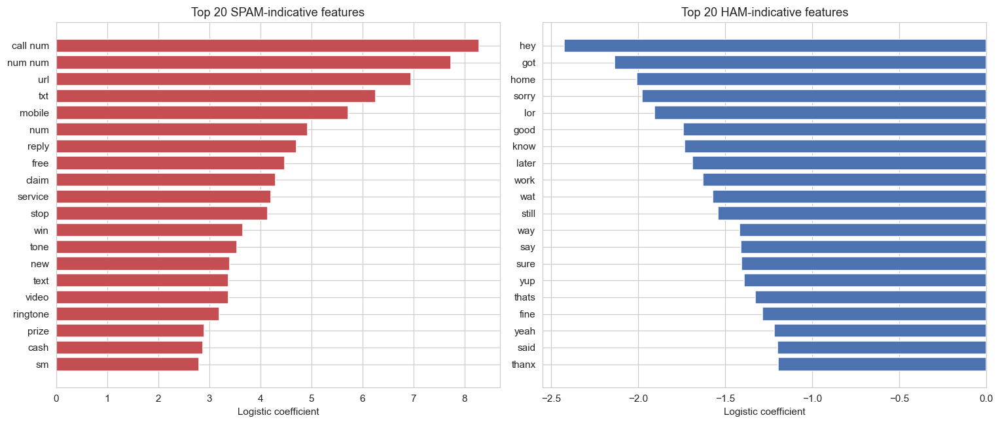

# 📩 Advanced NLP: SMS Spam Classification Pipeline


## 📖 Project Overview
This repository contains the deliverables for the **Level 3 (Advanced) Task 2: Natural Language Processing (NLP) - Text Classification** completed during my 1-month internship at **Codveda Technologies**. 

The objective of this project is to build a robust, production-ready machine learning pipeline capable of accurately classifying SMS messages as **Spam** or **Ham (Non-Spam)**. Going beyond basic requirements, this project implements a complete end-to-end workflow—from raw text preprocessing and feature engineering to multi-model evaluation, interpretability, and deployment-ready pipeline serialization.

## 🎯 Internship Task Requirements Met
- [x] **Text Preprocessing:** Tokenization, stopword removal, stemming (Porter), and lemmatization (WordNet).
- [x] **Numerical Representation:** Converting text to numerical features using TF-IDF Vectorization (Unigrams + Bigrams).
- [x] **Model Training:** Training multiple classification models (Naive Bayes, Logistic Regression, Linear SVC, Random Forest).
- [x] **Model Evaluation:** Comprehensive assessment using Accuracy, Precision, Recall, F1-Score, and ROC-AUC.
- [x] **Tools Used:** Python, NLTK, Scikit-learn, Pandas, Matplotlib, Seaborn.

## 🌟 Why This Project Stands Out
This project is designed to demonstrate not just an understanding of NLP, but an ability to build robust, reliable, and interpretable machine learning systems:
1. **Systematic Model Comparison:** Rather than training a single model, four algorithms were trained and benchmarked using 5-fold Stratified Cross-Validation to ensure stability.
2. **Advanced Feature Engineering:** Utilized `sublinear_tf=True` to dampen the impact of high-frequency words, and incorporated n-grams `(1, 2)` to capture critical contextual phrases like *"free entry"* or *"claim now"*.
3. **Model Interpretability:** Extracted and visualized the top 20 features driving spam and ham predictions, providing transparent insight into the model's decision-making process.
4. **Production-Ready Deployment:** Built a serialized `scikit-learn` Pipeline using `joblib` that accepts raw text and outputs predictions instantly, eliminating the need for manual preprocessing during inference.
5. **Probability Calibration:** Implemented `CalibratedClassifierCV` for the Linear SVC model to obtain reliable probability scores (necessary for ROC-AUC analysis), which standard SVMs do not natively provide.

## 📊 Dataset
The project utilizes the **SMS Spam Collection Dataset** (5,572 messages). 
- **Ham (0):** 4,825 messages
- **Spam (1):** 747 messages
- *Note: The dataset is automatically downloaded via URL within the notebook; a synthetic fallback is provided if the network is unavailable.*

## ⚙️ Methodology & Workflow

### 1. Exploratory Data Analysis (EDA)
Analyzed class balance, message length distribution, and average word counts per class. Spam messages tend to be significantly longer (avg. 23.9 words) compared to ham messages (avg. 14.3 words).
> **📍 Image Placement:** Upload your `nlp_eda.png` to the root of your repository. 
> 

### 2. Text Preprocessing
Implemented a custom `preprocess()` function that:
- Converts text to lowercase.
- Replaces URLs, emails, and numbers with placeholder tokens (`url`, `email`, `num`).
- Removes punctuation.
- Tokenizes and removes English stopwords.
- Applies **Lemmatization** (chosen over stemming for better semantic representation).

### 3. Feature Extraction
Converted text to a numerical matrix using **TF-IDF (Term Frequency-Inverse Document Frequency)**:
- `ngram_range=(1, 2)`: Captures both single words and two-word phrases.
- `max_features=10,000`: Limits vocabulary to the most informative terms.
- `min_df=2`: Ignores terms appearing only once.
- `sublinear_tf=True`: Applies logarithmic scaling to term frequencies.

### 4. Model Training & Evaluation
Four models were trained and evaluated:
| Model | Accuracy | Precision | Recall | F1-Score | CV F1 | AUC |
| :--- | :---: | :---: | :---: | :---: | :---: | :---: |
| **Naive Bayes** | 0.9848 | 0.9648 | 0.9195 | 0.9416 | 0.9362 | 0.9914 |
| **Logistic Regression** | 0.9883 | 0.9789 | 0.9329 | 0.9553 | 0.9186 | 0.9934 |
| **Linear SVC (Calibrated)** | **0.9892** | **0.9660** | **0.9530** | **0.9595** | **0.9371** | **0.9944** |
| **Random Forest** | 0.9668 | 1.0000 | 0.7517 | 0.8582 | 0.8444 | 0.9902 |

**Best Model:** Linear SVC achieved the highest F1-Score (0.9595) and Accuracy (98.92%), demonstrating an excellent balance between precision and recall.

> **📍 Image Placement:** Upload your `nlp_roc.png` and `nlp_confusion.png` to the root of your repository.
> 
> 

### 5. Model Interpretability
Extracted the top coefficients from the Logistic Regression model to understand what the model learned. 
- **Top Spam Indicators:** *call, num, url, txt, mobile, reply, free, claim, service*
- **Top Ham Indicators:** *hey, got, home, sorry, lor, good, know, later, work*

> **📍 Image Placement:** Upload your `nlp_top_features.png` to the root of your repository.
> 
---
### 6. End-to-End Deployment Pipeline
Created a unified `Pipeline` that combines TF-IDF vectorization and Logistic Regression. The final model is saved as `nlp_spam_pipeline.joblib` for immediate use.

**Live Testing Example:**
```python
# Load the saved pipeline
import joblib
pipeline = joblib.load("nlp_spam_pipeline.joblib")

# Test on new, unseen messages
new_texts = [
    "Congratulations! You won a free iPhone, click now to claim",
    "Hey, are we still meeting for coffee tomorrow at 10?",
    "URGENT: verify your account now or it will be suspended"
]
predictions = pipeline.predict(new_texts)
# Output: ['SPAM', 'HAM', 'HAM']

---
## 🤝 Contributing

Contributions, issues, and feature requests are welcome!  
Feel free to check 

---

## 📄 License

This project is licensed under the MIT License – see the [LICENSE](LICENSE) file for details.

---

## 👥 Author

**Your Name**  
- GitHub: [@lipril](https://github.com/lipril)  
- LinkedIn: [LinkedIn](https://www.linkedin.com/in/liprilomar/)

---

## 🙏 Acknowledgments

- Dataset source:https://www.kaggle.com/datasets/saurabh00007/iriscsv  

---

**⭐ If you find this project useful, please consider giving it a star!**